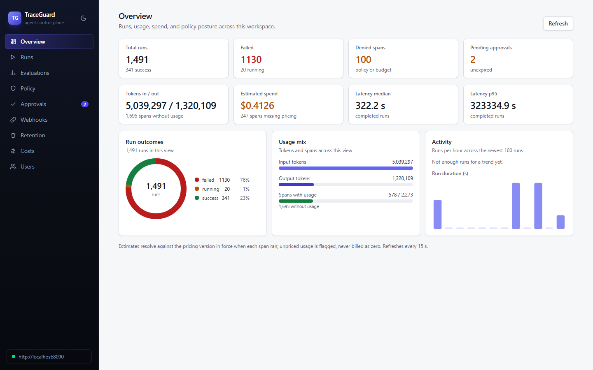
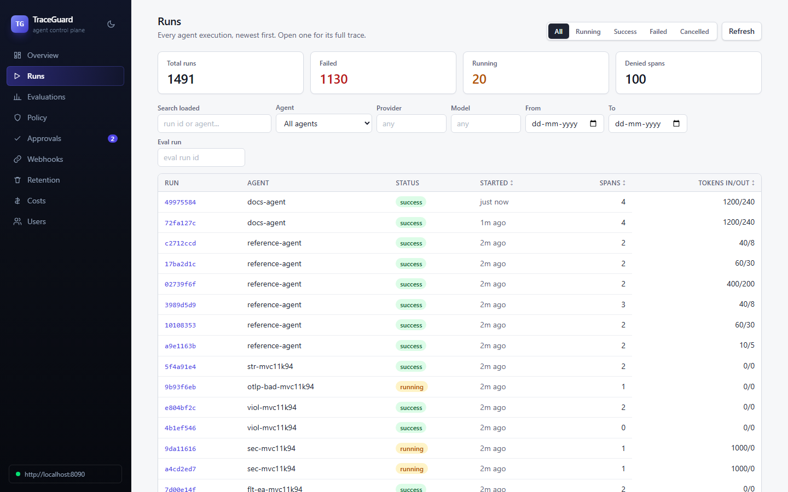
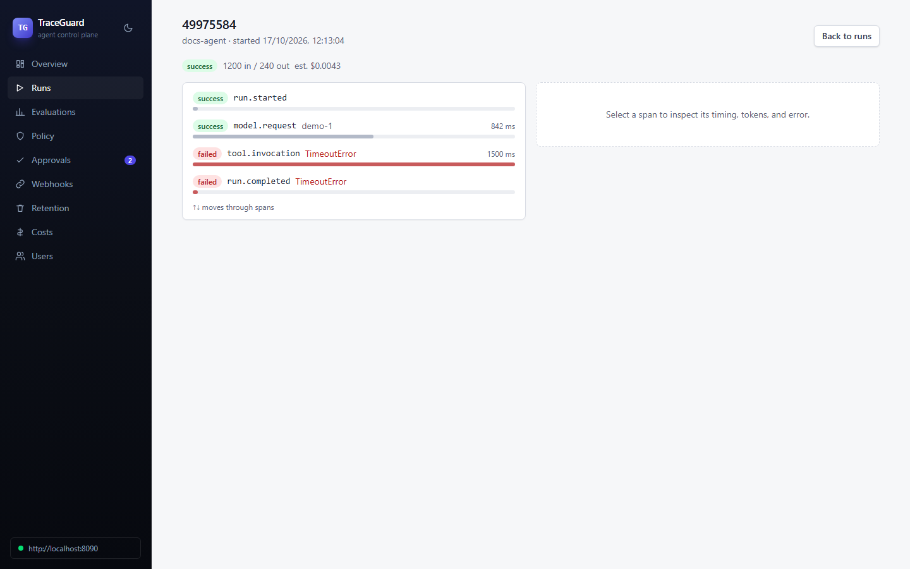
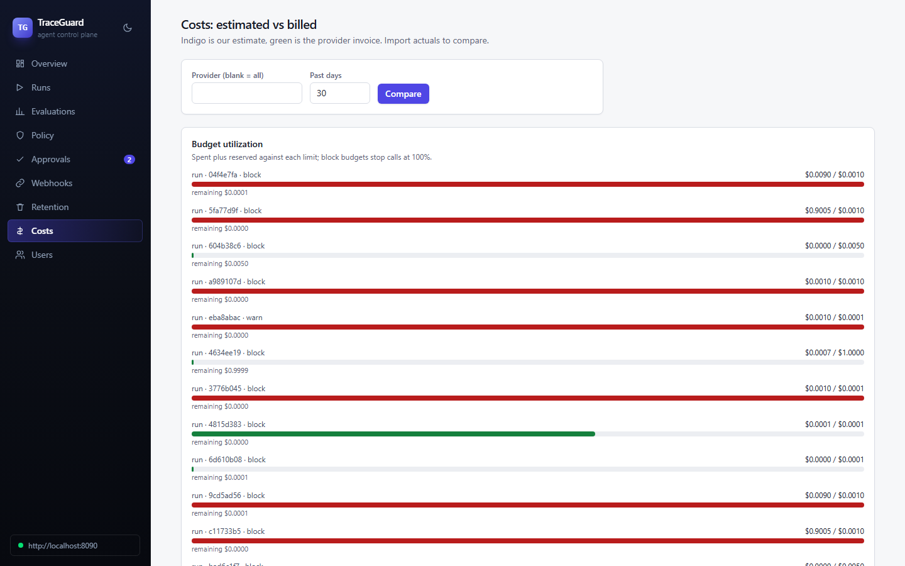
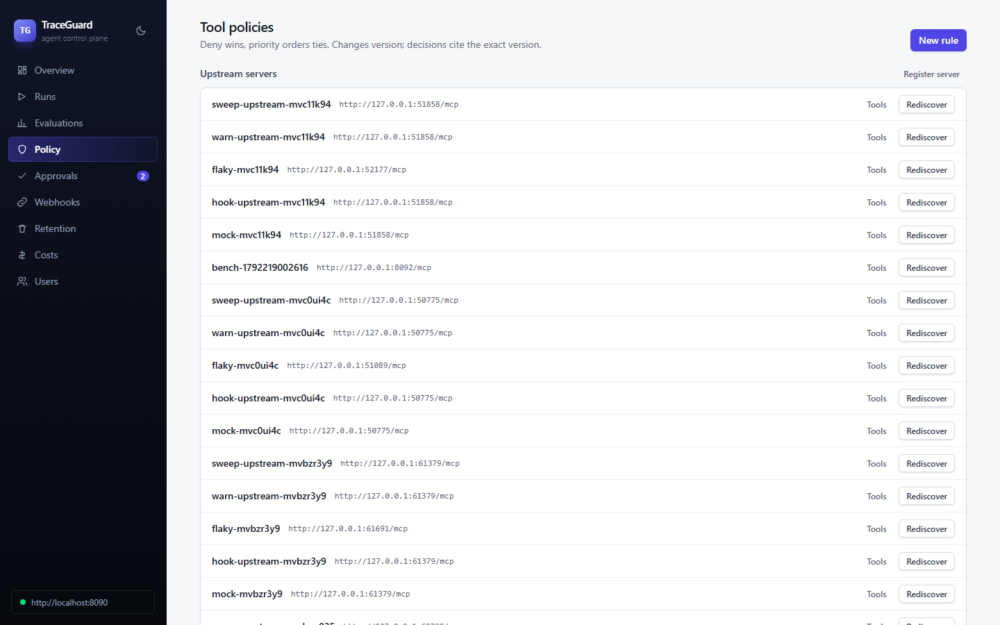
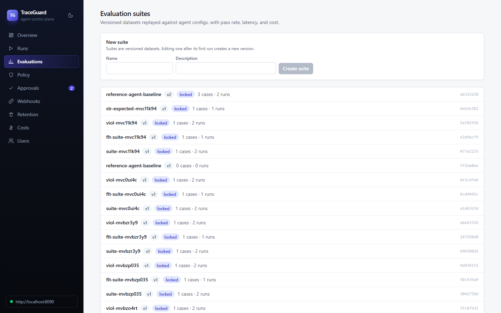

# TraceGuard

Self-hosted control plane for AI agents: execution tracing, cost control
with budgets, MCP tool policy enforcement with human approvals, and
scripted evaluation workbench.

## What it looks like

| | |
|---|---|
|  |  |
| Overview: runs by status, tokens, spend, latency percentiles, denied calls, pending approvals | Runs: search, sort, filters by agent, status, date, provider, model, and eval run |
|  |  |
| Trace: nested spans with per-span usage, cost, and the error class apart from policy denials | Costs: spend by model, budget utilization, estimates against imported provider actuals |
|  |  |
| Policy: server registration with tool quarantine, rules, budgets, and audit history | Evaluations: suites, per-case results, and a two-run comparison |

Regenerate these from the current build with `node scripts/screenshots.mjs`
against a running stack; see the file header for the commands.

## Run it

Dev ports: API 8090, gateway 8091, mock tools 8092 (internal only), web 5173.

1. Copy `.env.example` to `.env` and set `API_KEY` and `APPROVER_KEY`.
2. `docker compose up --build`
3. Apply migrations in order: `for f in apps/api/migrations/*.sql; do psql $DATABASE_URL -f "$f"; done`
4. Install the SDK and run the demo: `python -m pip install ./sdks/python`
   then `TRACEGUARD_URL=http://localhost:8090 python examples/demo-agent/main.py`
5. Open http://localhost:5173, set the API URL and key in the header, browse runs.

## What works now

- `POST /v1/ingest/events` validates with Zod, dedupes on `event_id`, auto-creates workspace, agent, and run records.
- `GET /v1/runs`, `GET /v1/runs/:id`, `GET /v1/runs/:id/trace`, `GET /v1/runs/:id/usage` read stored runs with token and cost breakdowns.
- Gateway on :8091: upstream registry, tool discovery with definition pinning, allow/deny/approval policies, single-use bound approvals, hash-chained audit.
- Budgets with atomic reserve-and-settle plus a Python `BudgetGuard` wrapper.
- Evaluations: versioned suites, scripted replay, deterministic assertions, run comparison.
- The dashboard has Overview, Runs, Evaluations, Policy, Approvals, Webhooks,
  Retention, Costs, and Users tabs: KPI tiles with usage and spend charts, run
  search and traces, suite creation and runs with comparison, server
  registration with tool quarantine, budget management and audit history,
  the approval queue, webhook subscriptions with delivery log, retention
  rules with run history, cost variance, and team, key, and workspace
  management.
- `POST /v1/traces` accepts OpenTelemetry OTLP/HTTP JSON with GenAI
  conventions, so instrumented frameworks land without a new SDK. Set
  `OTEL_EXPORTER_OTLP_PROTOCOL=http/json` on the exporter. Spans in one
  trace share a run, retries upsert by stable ids, and
  `POST /v1/admin/finalize-stale-runs` closes runs orphaned by crashes.
- Webhooks report denials, approvals, budget breaches, and finished
  evaluations to operator URLs with an HMAC signature. Delivery never
  blocks the decision, every attempt is logged, and failures retry from
  `POST /v1/webhooks/deliveries/:id/retry`.
- Retention rules age out runs, terminal approvals, and delivery logs on a
  cron-driven run endpoint. Policies, decisions, pending approvals, audit
  history, and money tables are never deletion targets.
- Reconciliation imports provider actuals and compares them against
  estimates per model and period, with a Costs tab showing variance.
- Users with scoped keys: first registration bootstraps the admin, then
  member keys ingest and call tools while approver keys decide. Memberships
  confine member writes and reads to their workspaces; foreign ids read as
  missing.
- `GET /healthz`, `GET /readyz` report liveness and database state.
- Python SDK sends events over HTTP with a bounded queue and never raises into the agent.
- TypeScript SDK (`@traceguard/sdk`, zero dependencies) mirrors it: events, budget guard, flush.
- `examples/demo-agent` submits a sample run and fetches its trace.
- `examples/mock-tools` is a two-tool upstream for gateway demos.
- `infra/k8s` holds Kubernetes manifests with a migrate job; see `docs/kubernetes.md`.

## Phase 4: cost and budgets

- `POST /v1/pricing` versions model prices, old versions stay so past
  estimates keep meaning. Money is integer micro-dollars, never floats.
- `POST /v1/budgets` sets run or agent limits with block or warn effects,
  and a reporting `period` of `lifetime` (default), `day`, `week`, or
  `month`. Windowed spend is summed from the append-only ledger, so no
  counter is reset on a schedule and past windows stay explainable.
- A hold that is abandoned (a caller that dies between reserve and settle)
  is released by the next check against that budget, and the release is
  audited. Without that the worst case stayed reserved forever and the
  budget answered 409 with `spent_micro` at zero.
- `GET /v1/runs/:id/usage` breaks tokens and cost down per span against the
  price in force at the time. Cached input tokens bill once at the cached
  rate, never on top of the full input rate; spans with no matching price
  report NULL and list under `missing_pricing`, never zero.
- The managed path reserves before the call under a row lock, then settles
  to the measured cost. A blocked call gets 409 and the SDK raises
  `BudgetExceeded` instead of calling the provider.
- The Python SDK gained `BudgetGuard` plus `flush`, and now stamps Zulu
  timestamps the API accepts.
- The trace header shows the estimated run cost from the usage endpoint.

## Phase 5: evaluation workbench

- Suites version on creation and lock on first use. Cases carry scripted
  behavior plus deterministic assertions: exact, contains, regex, a JSON
  schema subset with nested objects, arrays, and enums, tool names or an
  ordered sequence, and final status. A case with an `expected` value and
  no scripted output replays it, and `input_payload` rides the run's first
  span for provenance.
- Starting a run replays every case for N trials, writes real runs you can
  open in the dashboard, and records pass state, latency, cost, and the
  config fingerprint. Per-run overrides let a second version run the same
  locked dataset differently.
- The compare endpoint reports pass rate, latency spread, cost, and denied
  tool violations side by side, with missing data shown as missing.
- The dashboard has an Evaluations tab: suite list, per-case results with
  failure reasons, links back to traces, and a two-run comparison.

Unit checks: `npm install && npm test`. The Python SDK suite runs separately
(`pip install "./sdks/python[dev]" && python -m pytest sdks/python`), the
browser scenarios with `npm run test:e2e`, the Kubernetes manifests with
`python infra/k8s/check.py`, and the performance table with
`node scripts/bench.mjs`.

## Documentation

| File | What is in it |
|---|---|
| `docs/architecture.md` | components, request flow, and where enforcement lives |
| `docs/security.md` | what the platform guarantees, what it does not, and the sensitive-data inventory |
| `docs/configuration.md` | every environment variable and the scoping rules |
| `docs/operations.md` | backups, restores, migrations, and the cron endpoints |
| `docs/PERFORMANCE.md` | how to measure, and one recorded run of the targets |
| `docs/kubernetes.md` | the manifests and how to deploy them |

## Phase 3: trace dashboard

- `apps/web` is a read-only React dashboard: run list with status filter and
  Load more pagination, plus a trace view with a nested span tree, per-span
  detail, token totals, and denied-by-policy shown apart from failures.
- API URL and key are editable in the page header and kept in localStorage.
  Policy and approval actions live on their own tabs; run views stay
  read-only.
- Run it: `npm run dev --workspace=@traceguard/web` (port 5173) against the
  API on 8090, or `docker compose up web` for the built bundle.

## Phase 2: gateway and policy

- `POST /v1/servers`, `POST /v1/servers/:id/discover` register Streamable HTTP
  upstreams and pin each tool definition hash. Changed definitions quarantine
  until re-approved. Upstream credentials stay in the gateway and are never
  returned by reads. Upstream URLs are validated at registration, discovery,
  and call time; private ranges need `ALLOW_PRIVATE_UPSTREAMS=true` and cloud
  metadata addresses are always refused.
- Policy effects are allow, deny, and require_approval. Deny overrides
  everything, priority only orders rules with the same effect, and unmatched
  calls are denied. Conditions use a fixed operator set: required fields plus
  `path_within`, `regex`, `enum`, and `max_length` per argument.
- A call needing approval returns 202 with an approval id and the gateway
  makes no upstream contact. The client retries with the approval id after a
  human decides with the separate approver key. Approvals are single-use and
  bound to caller, server, tool, canonical args, and request id. Agent keys
  get 401 on the decision endpoint. Expired holds flip to expired on the next
  list, so queues never show dead entries.
- Every decision lands in `policy_decisions` citing the exact policy version,
  and every admin or execution outcome lands in the hash-chained `audit_events`
  table. Policies are immutable versions: an update supersedes, never edits.
- Try it: `node examples/mock-tools/server.mjs`, register
  `http://localhost:8092/mcp` (needs `ALLOW_PRIVATE_UPSTREAMS=true` locally),
  discover, add an allow rule, and call through
  `POST /v1/gateway/tools/call` on port 8091.

## Status

Every roadmap phase above is implemented: ingestion and the trace dashboard,
the gateway with policy, approvals, and audit, budgets and pricing, and the
evaluation workbench. Webhooks, retention, reconciliation, users and
memberships, and OTLP ingestion landed on top; their sections are under
"What works now".

## Scope decisions from the review

- Streamable HTTP only for MCP upstreams. No stdio process spawning in the gateway.
- Approval arguments are sealed (AES-256-GCM) while a request is pending. Once it is denied, expires, or executes, the sealed arguments are cleared and only a redacted summary and the argument hash remain.
- Deny overrides allow. Priority breaks ties within the same effect only.
- Money uses NUMERIC or integer micro-dollars, never floats. Unknown model means NULL cost, not zero.
- Gateway fails closed. SDK telemetry fails open. Budget wrapper fails closed.

## Roadmap: next integrations

- Live evaluation adapters: register a real agent endpoint so replays exercise the
  agent itself, not just the recorded execution config. This is the one
  functional requirement still short of the spec: replay runs a registered
  scripted adapter, and `eval_results.agent_run_id` already links each case to a
  real run, so an HTTP adapter is the missing piece rather than a redesign.
- Projects as a first-class policy target (agent, project, server, tool), with
  per-project budgets. The spec names a project dimension in four places
  (policy targeting, budgets, cost grouping, cost explorer); nothing in the
  schema carries one today.
- Cost explorer drill-downs: per-agent breakdowns and an
  input-vs-output cost split.
- OTLP export from TraceGuard, plus log ingestion alongside traces.
- SSO/OIDC for the dashboard, replacing bearer-token login.
- Alerting integrations (Slack, PagerDuty) on top of the existing webhook events.
- A timing instrument inside the gateway, so the §14 policy-decision budget can
  be measured on its own rather than inferred from a whole-call figure.
